<div align="center">

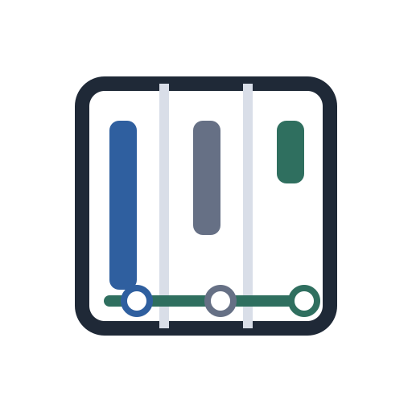

# Zotero Reading Flow

**Keep your place, even when you skip ahead.**

[](https://github.com/Moonweave-Research/zotero-reading-flow/releases/latest) [](https://github.com/Moonweave-Research/zotero-reading-flow/actions/workflows/verify.yml) [](https://www.zotero.org/download/) [](LICENSE)

[Install](#install) · [How it works](#a-simple-reading-workflow) · [Reading statistics](#reading-statistics) · [Questions](#questions) · [Build from source](#build-from-source)

</div>

Reading Flow helps you return to the page you meant to keep. Leave a **reading bookmark**, browse another section, and come back without losing your place. See that bookmark, your last viewed page, and your chosen reading status directly in Zotero.

> [!IMPORTANT]
> **Most workflow screenshots show Reading Flow 1.3.8.** The new **Reading started** example shows the 1.3.9 QA build, now available in the [latest release](https://github.com/Moonweave-Research/zotero-reading-flow/releases/latest). The captions call out where older screenshots use earlier date labels.

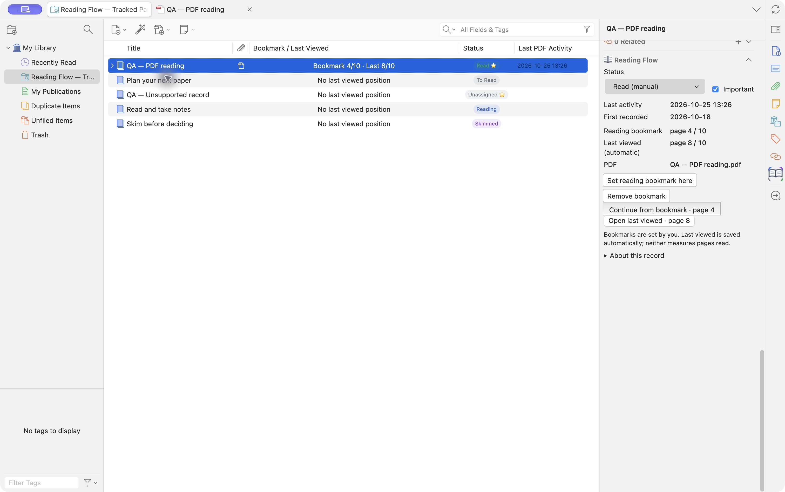

*See each reading stage in the library, with Important kept separate. These English workflow captures use a separate test library; the Reading started example below has a Korean Zotero host UI. Click a full-window image to inspect it, or use the detail views below.*

## Install

1. Download **`zotero-reading-flow.xpi`** from the [latest published release](https://github.com/Moonweave-Research/zotero-reading-flow/releases/latest), or [build from source](#build-from-source).
2. In Zotero, open **Tools → Plugins**.
3. Open the gear menu, choose **Install Plugin From File…**, and select the `.xpi`.
4. Restart Zotero after installing or updating.

Supports **Zotero 9 and 10**. The latest screenshots were verified on **Zotero 10.0.6 for macOS**. Use Zotero's plugin installer when updating so both the package and its registered version are updated.

## At a glance

| What you want to know | Where it appears | What it means |
| --- | --- | --- |
| Reading stage and Important flag | [Library row](docs/assets/reading-status-library.jpg) or the Reading Flow panel | The stage is your choice; Important is independent. |
| Page to return to | [Bookmark here](docs/assets/reading-bookmark-button.jpg), then the [panel](docs/assets/reading-bookmark-panel.jpg) | A bookmark changes only when you set or remove it. |
| Most recently viewed page | Library row or panel | Saved automatically when you visit a PDF page; a brief visit counts. |
| When you started Reading | [Reading started example](docs/assets/reading-started-qa-v1.3.9.png) | Recorded when the item enters Reading; older records are not guessed. |
| PDF activity and manual Read count | [Reading Statistics](#reading-statistics) | PDF activity describes saved page positions. **Read** is always your manual choice. |
| Papers with Reading Flow data | [Tracked-papers list](docs/assets/reading-list-sidebar.jpg) | A native Zotero Saved Search, not a folder for one status. |

**A page visit is not proof that you read it.** Reading Flow does not calculate pages read or mark an item Read when you reach the last page.

## A simple reading workflow

### 1. Choose a reading stage

Select a paper and set its **Status** in the Reading Flow panel or context menu. Choose **Reading** when you start; the panel records **Reading started**. The date updates if you start Reading again. Existing items are not backfilled because their earlier start date cannot be inferred reliably.

**Look for the open book.** In the optional combined **Reading Flow** column, changing **To Read → Reading** changes the orange closed-book symbol to an open book: **📙 → 📖**. The separate **Status** column spells out the stage, as shown in this close-up:

<table>
<tr><th>Status column — actual screenshot detail</th><th>Combined Reading Flow column — icon key</th></tr>
<tr>
<td>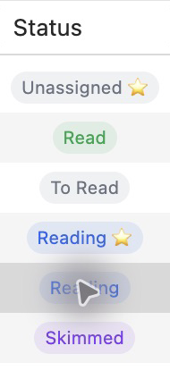</td>
<td>
<p><strong>📙 To Read</strong> — saved for later</p>
<p><strong>📖 Reading</strong> — currently reading</p>
<p><strong>📘 Skimmed</strong> — skimmed, with the stage chosen by you</p>
<p><strong>📗 Read</strong> — marked Read by you</p>
<p><strong>⭐ Important</strong> — an independent flag that can accompany any stage</p>
</td>
</tr>
</table>

*The icon key explains the current symbols; it is not a second screenshot. Enable the optional **Reading Flow** column with Zotero's native column chooser to see the books. The separate **Status** column uses text labels. Zotero's item-type icon beside the paper title stays the same. Book emoji artwork varies by operating system.*

**Unassigned** means no stage has been chosen or inferred. **Reading (automatic)** can appear after PDF activity or a bookmark when no manual stage is set; the open book alone does not tell you whether the stage was set manually. Check the panel's Status label for that distinction. Reaching the last page never changes the book to **Read**.

**A start date is separate from PDF activity:**

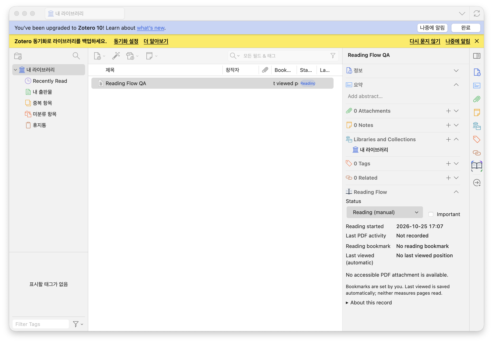

*This isolated QA item has no PDF attached. The start date is present while PDF activity and page positions are not. Reading Flow labels are in English; the host Zotero app uses a Korean locale in this capture.*

### 2. Save the page you want to return to

Open a PDF and choose **Bookmark here** in the **upper-right PDF toolbar, near Aa**. This saves a reading bookmark at the current page. No reading mode or timer needs to be switched on.

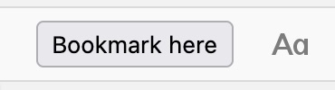

*This is the button to look for inside the PDF reader.*

<details>
<summary>Locate it in the full PDF reader window</summary>

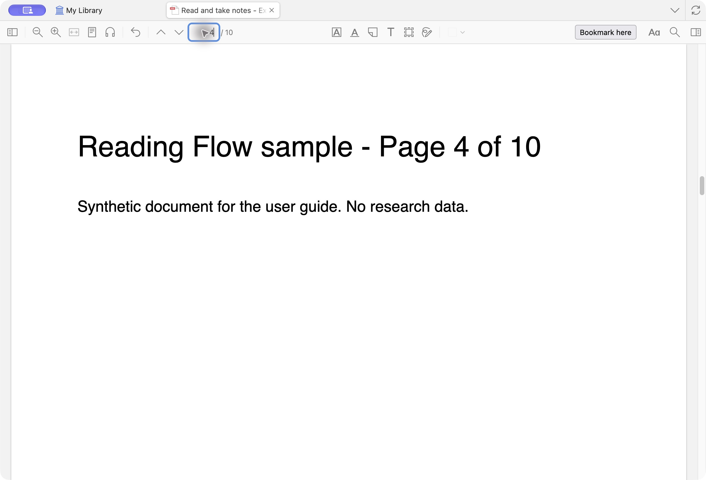

</details>

### 3. Browse freely

Jump to the references, inspect a figure, or look at another page. Reading Flow updates **Last viewed (automatic)** while keeping your reading bookmark in place.

| What you see | What it means |
| --- | --- |
| **Reading bookmark** | A page you deliberately saved. Only a bookmark action changes it. |
| **Last viewed (automatic)** | The most recently displayed PDF page, including a brief visit. |
| **Status** | Your chosen stage, or **Reading (automatic)** when a bookmark or recorded PDF activity exists without a manual stage. |

**Neither a bookmark nor an automatic position measures pages read.** Visiting the last page does not mark a paper **Read**. Page numbers refer to positions in the PDF file; printed page labels may differ.

### 4. Continue from your bookmark

Return to the library, select the paper, and click the **book-shaped Reading Flow icon** on the right. You can also right-click the paper and choose **Reading Flow → View Reading Flow**.

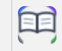

*This sidebar shortcut opens the panel. The changing book symbols described above appear in the combined library column.*

Choose **Continue from bookmark** to return to your marked page. **Open last viewed** takes you to the automatic position instead. Without a bookmark, the primary action continues from the last viewed position, or opens the PDF when no saved position is available.

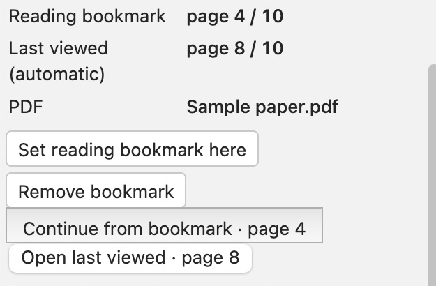

*In this example, **Continue from bookmark · page 4** returns to the page you saved; **Open last viewed · page 8** returns to the page you browsed afterward. **Remove bookmark** clears the bookmark, leaving the automatic position available.*

<details>
<summary>See the Reading Flow panel</summary>

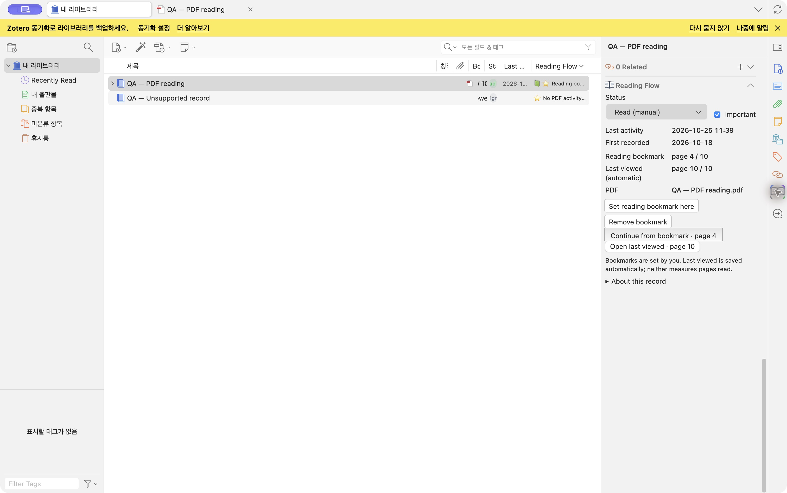

*This panel capture uses Reading Flow 1.3.8, whose date rows use the earlier labels **First recorded** and **Last activity**. In 1.3.9, these are clarified as **Reading started** and **Last PDF activity**; see the current example above. The bookmark and automatic position remain separate.*

</details>

**Changed your mind?** Use **Undo** after setting a bookmark, or **Remove bookmark** in the panel. Undo is available during the current app session and does not overwrite a newer bookmark change from another client.

## Organize your reading

- **Choose a stage:** `To Read`, `Reading`, `Skimmed`, or `Read`. Set it in the panel or the paper's **Reading Flow** context menu. **Important** is a separate flag, so a paper can be both **Read** and **Important**.
- **Keep automatic status:** choose **Clear Manual Status (Use Automatic)** in the context menu to remove your manual override. Untouched items remain **Unassigned**.
- **Scan the library:** use Zotero's native column chooser to show **Bookmark / Last Viewed**, **Status**, **Last PDF Activity**, or the optional combined **Reading Flow** column. Column visibility and layout stay under Zotero's control.
- **Choose a density:** in **Settings → Zotero Reading Flow**, **Compact** shows a status icon with position and activity date; **Icons** keeps the status icon with full information in its tooltip. This changes only the optional combined column.
- **Create a reading list:** **Settings → Zotero Reading Flow → Add to Left Sidebar** creates one native **Reading Flow — Tracked Papers** Saved Search per selected editable library.
- **Set a default for new items:** **Status for newly added papers** starts at **Unassigned**. Choosing a default affects eligible items added afterward; it does not rewrite the existing library.

## Reading list and settings

Open **Settings → Zotero Reading Flow** to add **Reading Flow — Tracked Papers**, choose the optional combined column's density, or set a default for future eligible additions. The default **Unassigned** leaves new items untouched. Existing items keep their current data.

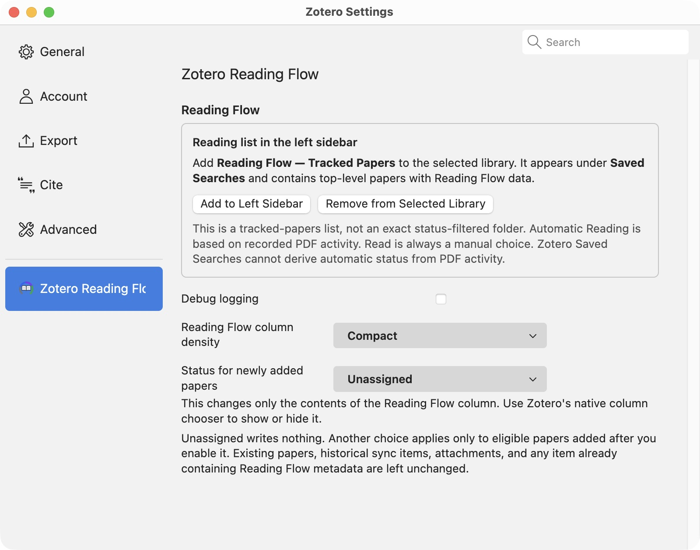

<details>
<summary>See the tracked-papers list in Zotero</summary>

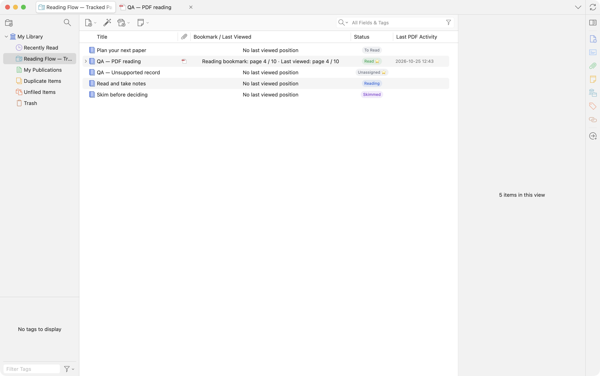

*The selected Saved Search includes papers with Reading Flow metadata. It is not a folder for one status. Untouched, unassigned papers stay outside it; an unassigned paper with Important metadata can appear.*

</details>

## Reading statistics

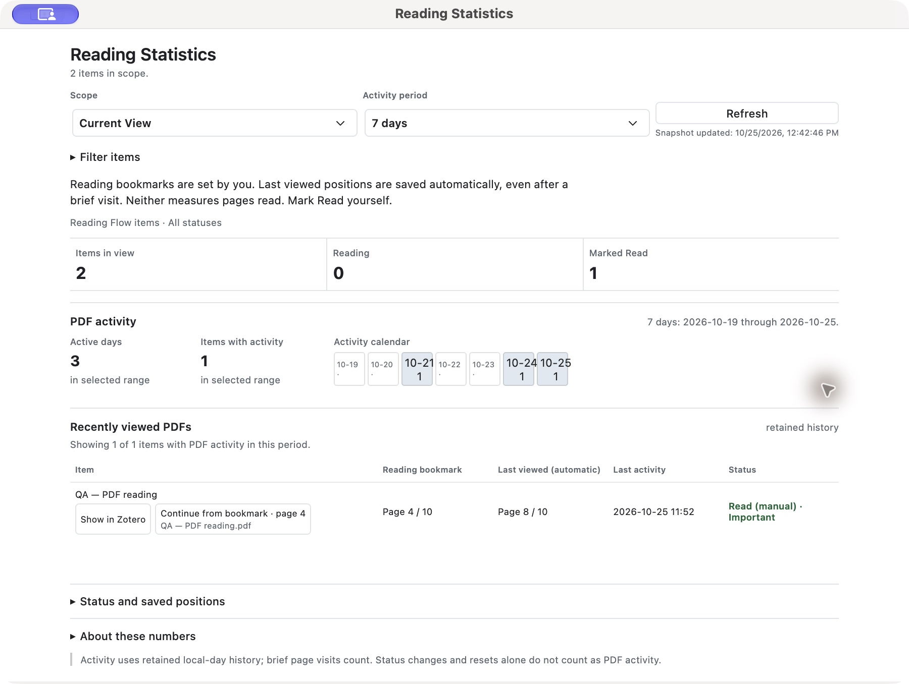

*You marked page 4, then looked at page 8. The bookmark stays at page 4; Marked Read remains a manual judgment. This 1.3.8 capture says **Last activity**; 1.3.9 calls it **Last PDF activity**.*

Open **Tools → Reading Statistics**, or right-click a paper and choose **Reading Flow → View Current View Statistics**.

The dashboard brings together **reading bookmarks, automatic positions, last PDF activity, and status**. Its calendar shows days with recorded PDF page changes. Select an active day to inspect the matching papers; **Show in Zotero** selects a paper, and the PDF action opens the displayed bookmark or saved position.

- **Check Scope first.** A newly opened dashboard starts at **Current View**. Choose **Selected Library** for the whole active library. Reopening an existing statistics window preserves its filters.
- **Use the activity period for activity.** Current status and position describe the item now. The period controls which retained activity is shown.
- **Treat Marked Read as your judgment.** It counts papers explicitly marked **Read**, not papers that reached the last page.
- **Expand details when needed.** **Position history** contains available daily farthest-position comparisons and reset counts. **Status and saved positions** contains the optional breakdowns.

Detailed PDF activity history retains at most **366 days**; older or legacy activity may be missing. A brief visit can update the last PDF position, but that does not prove the page was read.

## Questions

### Does it decide whether I actually read a page?

No. It records navigation and a bookmark you explicitly choose. A short visit counts as an automatic position update; time spent on a page does not prove that you read it. Set **Read** yourself.

### Will it change my PDFs or replace my existing records?

PDF files are not modified. Reading Flow keeps its data in one `ReadingFlow:` line in the parent item's **Extra** field and preserves unrelated Extra content. Existing automatic positions are not converted into reading bookmarks. Disabling or uninstalling the plugin leaves its metadata in place.

### Does it sync between devices?

The Extra record follows Zotero's metadata sync. Bookmarks identify attachments by Zotero key, so they do not depend on the same local numeric item ID. The PDF must also be available on the other device.

Use **1.3.8 or newer** on every device that needs to read or edit bookmark records. **Reading started** records require **1.3.9 or newer** on every device that needs to view or edit them. Version 1.3.8 preserves those newer records but shows them as unsupported, without their details or editing controls. Actual device-to-device delivery has **not yet been verified**; attachment-key resolution, supported-client round trips, and previous-writer refusal have been tested.

### What if a paper has several PDFs, or a file is missing?

A bookmark belongs to its specific PDF. The panel distinguishes that file from the automatically tracked PDF when they differ. A missing bookmarked file is reported as unavailable; its page is not silently applied to another attachment. With several open PDFs for one paper, use **Bookmark here** inside the intended PDF.

### What does Reset tracked PDF positions clear?

**Reading Flow → Advanced → Reset tracked PDF positions** clears automatic current and maximum positions. It preserves the reading bookmark, manual status, Important flag, reading start date, last PDF activity, and retained history. To clear the bookmark, use **Remove bookmark** in the panel.

### Where is Bookmark here? Why are my columns missing?

**Bookmark here** appears inside the PDF reader, not the library toolbar. Check that **1.3.8 or newer** is installed and restart after updating. For hidden columns, use the library's native column chooser. The optional combined **Reading Flow** column must be enabled manually.

Position tracking supports **PDFs**. Manual status and Important also work for items without a PDF; EPUB positions are not tracked. For other problems, see [Troubleshooting](docs/TROUBLESHOOTING.md) or [report an issue](https://github.com/Moonweave-Research/zotero-reading-flow/issues).

## Build from source

Requires **Node.js 22**, npm, Git, `zip`, and `unzip`. Clone with history: verification uses a pinned previous client to check that old writers preserve new bookmark records.

```bash
git clone https://github.com/Moonweave-Research/zotero-reading-flow.git
cd zotero-reading-flow
npm ci
npm run verify
```

Install the resulting **`zotero-reading-flow.xpi`** through **Tools → Plugins → Install Plugin From File…**, then restart Zotero. Verification runs TypeScript checks, unit tests, the XPI build, package/update-manifest checks, and previous-writer compatibility checks. Generated artifacts are ignored by Git.

For maintainers: [documentation index](docs/README.md) · [release process](docs/RELEASE.md) · [release notes](CHANGELOG.md) · [test-profile checker](scripts/check-release-profile.js). Reading Flow has no separate reading-data upload service; plugin updates use its declared GitHub release channel. Zotero's own sync and network behavior are separate.
