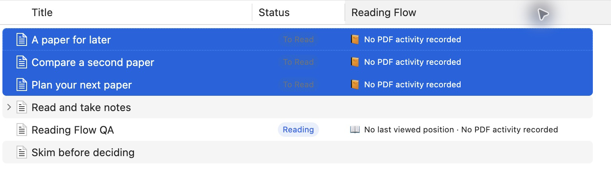
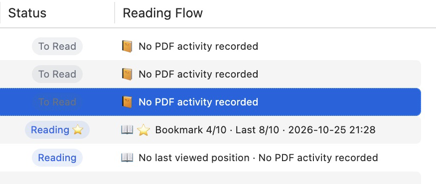
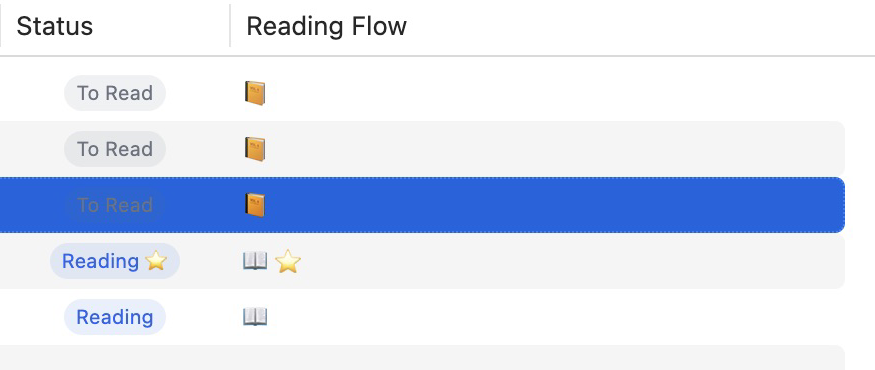
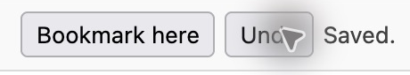
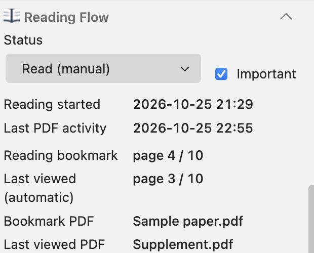
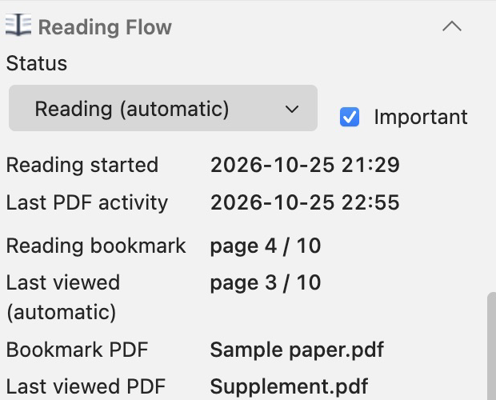
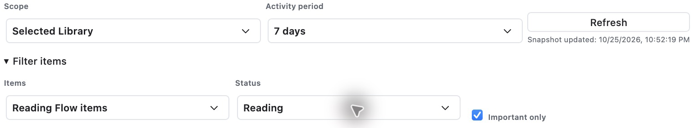
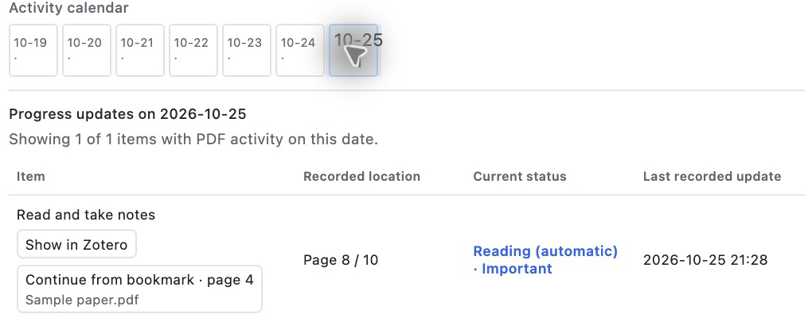
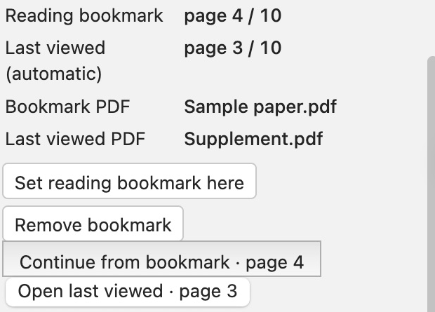
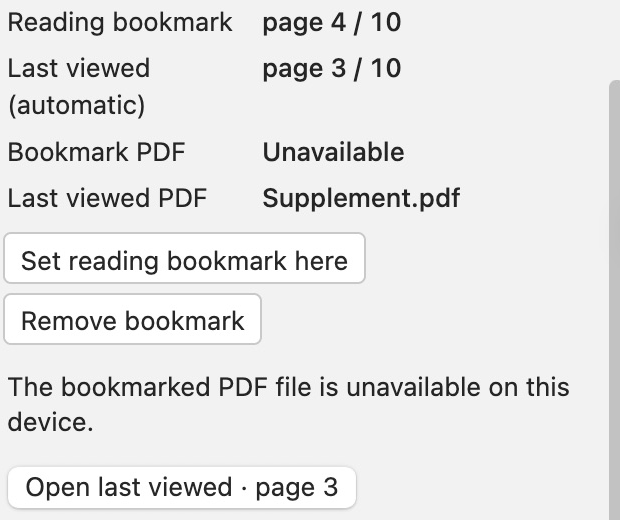

# More ways to use Reading Flow

[Back to the main reading workflow](../README.md#a-simple-reading-workflow)

These English Zotero 10.0.6 captures use Reading Flow 1.3.9 and synthetic papers in an isolated QA profile. Detail views crop the real captures; full-window images are linked where useful.

## Change several papers together

Select papers in Zotero's library, right-click, and open **Reading Flow**. Choose **Mark as To Read**, **Mark as Reading**, **Mark as Skimmed**, or **Mark as Read**. **Mark as Important** and **Clear Important** change the independent flag.

[See the actual multi-selection menu](assets/workflows/batch-menu.jpg).

*The three selected papers now share To Read. The other papers keep their own stages. These samples have no PDF activity; changing their stage does not invent activity.*

The result message reports changed, unchanged, skipped, and failed items. Selecting a parent paper and its PDF does not update that parent twice. Read-only or ineligible items are skipped; batches of 100 or more require confirmation.

## Compare Compact and Icons

First enable the optional combined **Reading Flow** column with Zotero's native column chooser. Open **Settings → Zotero Reading Flow → Reading Flow column density**.

**Compact** keeps the stage symbol, bookmark, automatic position, and PDF activity date together:

**Icons** shows the stage symbol and independent Important star. Hover over a cell for the full details:

*These are the same papers, with the same saved data. Only the combined column's presentation changed. The separate Status column stays visible in both examples. [Full Compact view](assets/workflows/density-compact.jpg) · [Full Icons view](assets/workflows/density-icons.jpg).*

## Undo a bookmark change

Immediately after **Bookmark here**, **Undo** appears beside it in the PDF toolbar:

Use **Undo** to restore the previous bookmark. In the library panel the action is called **Undo bookmark change**. Undo is available for the current app session and will not overwrite a newer bookmark change from another client.

**Remove bookmark** clears the bookmark while keeping the automatic last-viewed position. The panel's **Set reading bookmark here** requires one open PDF for the paper; use the intended PDF's toolbar when several are open. [Full PDF reader capture](assets/workflows/bookmark-undo.jpg).

## Return to automatic status

Right-click the paper → **Reading Flow → Clear Manual Status (Use Automatic)**.

- A paper with a bookmark or recorded PDF activity becomes **Reading (automatic)**.
- Without that evidence, the stage becomes **Unassigned**.
- The bookmark, automatic position, Important flag, and any previously recorded reading start date are retained.

This removes the manual override. It does not mark the paper Read or measure how many pages you read.

<table>
<tr><th>Before: Read (manual)</th><th>After: Reading (automatic)</th></tr>
<tr>
<td></td>
<td></td>
</tr>
</table>

*Only the stage's manual override changed. The checked Important flag, dates, bookmark, and automatic position are the same. [Full before view](assets/workflows/status-manual-before.jpg) · [Full after view](assets/workflows/status-automatic-after.jpg).*

## Explore the statistics filters

Open **Tools → Reading Statistics**. **Scope** chooses **Current View** or **Selected Library**. **Activity period** selects retained PDF activity; it does not reconstruct the paper's past status.

Expand **Filter items** to choose **Reading Flow items** or **All items (inventory)**, a stage, and **Important only**. Click an active calendar day to inspect papers with recorded PDF page changes on that date; click it again to clear the date selection.

*These filters leave one matching paper in this sample. [Full filtered dashboard](assets/workflows/statistics-filters.jpg).*

*The date detail shows a recorded location for that day, alongside the paper's current status. Its bookmark action returns to the page you deliberately saved. [Full selected-day dashboard](assets/workflows/statistics-day.jpg).*

**Show in Zotero** selects a paper in the library. The PDF action opens its displayed bookmark or automatic location. **Marked Read** counts your manual Read choices. Status changes alone do not count as PDF activity.

## Several PDFs or an unavailable attachment

A bookmark belongs to one specific PDF. When that PDF and the automatically tracked PDF differ, the panel names the files separately. Use **Bookmark here** inside the PDF you mean to mark.

*The bookmark belongs to **Sample paper.pdf**, page 4. The automatic position belongs to **Supplement.pdf**, page 3. Each button opens its own file and position. [Full two-PDF view](assets/workflows/multiple-pdfs.jpg).*

If the bookmarked file is unavailable, its page is not silently applied to a different PDF. If multiple PDFs for one paper are open, the panel's general bookmark button is disabled; each reader's **Bookmark here** still identifies the intended file.

*The saved page remains visible, but **The bookmarked PDF file is unavailable on this device** replaces the bookmark-opening action. The separate automatic position can still be opened. This QA file was restored after the capture. [Full unavailable-file view](assets/workflows/missing-bookmarked-pdf.jpg).*

[Back to the README](../README.md) · [Troubleshooting](TROUBLESHOOTING.md) · [Capture provenance](assets/README.md)
